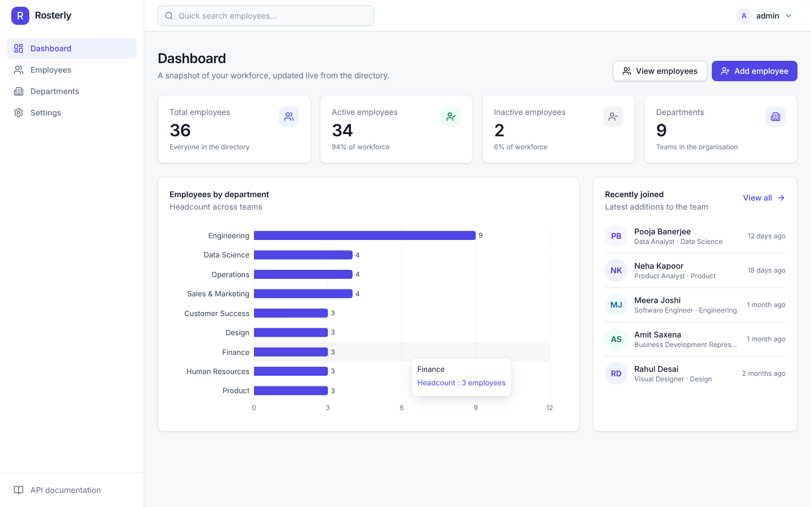
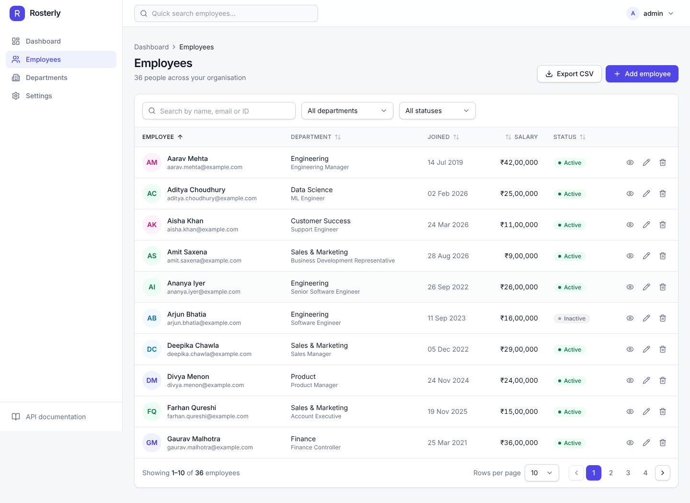
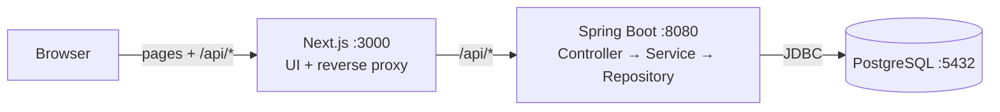

# Rosterly — Employee Management System

A full-stack employee management application: a **Next.js** web UI, a **Spring Boot** REST API and a
**PostgreSQL** database, with sessions-based administrator login, server-side search/filter/pagination,
a statistics dashboard, department management and CSV export.

Built for the Kloudspot India Private Limited candidate technical assessment.

| | |
|---|---|
|  |  |

More screenshots are in [`screenshots/`](screenshots/) (login, filtered list, validation, details, edit,
delete confirmation, departments, mobile and tablet layouts). They were captured from the running
application by `frontend/e2e/screenshots.spec.ts`.

## Contents

1. [Features](#1-features)
2. [Technology stack](#2-technology-stack)
3. [Architecture overview](#3-architecture-overview)
4. [Prerequisites](#4-prerequisites)
5. [Repository structure](#5-repository-structure)
6. [Environment configuration](#6-environment-configuration)
7. [Run with Docker Compose](#7-run-with-docker-compose)
8. [Run locally (development)](#8-run-locally-development)
9. [Database setup and migrations](#9-database-setup-and-migrations)
10. [Application URLs](#10-application-urls)
11. [API documentation (Swagger)](#11-api-documentation-swagger)
12. [API endpoint summary](#12-api-endpoint-summary)
13. [Sample API requests](#13-sample-api-requests)
14. [Tests](#14-tests)
15. [Postman collection](#15-postman-collection)
16. [Demo data](#16-demo-data)
17. [Troubleshooting](#17-troubleshooting)
18. [Security notes and limitations](#18-security-notes-and-limitations)
19. [Verification status](#19-verification-status)

---

## 1. Features

**Core**

* Employee records with: employee ID, full name, email, phone, department, designation, date of joining,
  salary, employment status (Active / Inactive) and created / updated timestamps.
* Create, view, edit and delete through real REST endpoints, persisted in PostgreSQL.
* Delete always asks for confirmation.
* **Directory** with server-side search (name, email, employee ID), department filter, status filter,
  sortable columns, pagination (10 / 20 / 50 per page), total counts, "clear filters", loading / empty /
  no-results / error states. All of them work together, and the state is kept in the URL.
* **Dashboard** with total / active / inactive employees, department distribution chart and recently joined
  employees. All numbers come from the backend.
* Forms with field-level validation on the client (Zod) **and** the server (Bean Validation); server errors
  such as duplicate IDs or emails are shown next to the right field and the entered values are kept.
  Duplicate submissions are blocked and unsaved changes are protected.
* Responsive, accessible UI (keyboard navigation, labelled controls, focus management in dialogs).

**Bonus features (all implemented)**

* **Authentication**: administrator login (session cookie, CSRF protection, BCrypt), HTTP Basic for tools.
* **Department management** (create / rename / delete; deleting a department that still has employees is rejected).
* **CSV export** of the current search + filters (all pages), with proper escaping and spreadsheet-formula
  injection protection.
* **Swagger / OpenAPI** documentation, **Postman** collection, Docker Compose, Flyway migrations,
  structured request logging, opt-in demo data.

## 2. Technology stack

| Layer | Technology |
|---|---|
| Backend | Java 21, Spring Boot 3.5, Spring Web, Spring Data JPA / Hibernate, Spring Security, Bean Validation, Flyway, springdoc-openapi, Maven |
| Database | PostgreSQL 16 (`pg_trgm` for search indexes) |
| Frontend | Next.js 15 (App Router), React 19, TypeScript (strict), Tailwind CSS 4, Radix UI primitives (shadcn-style components), Lucide icons, React Hook Form + Zod, TanStack Table + TanStack Query, Recharts, Sonner toasts |
| Testing | JUnit 5, Mockito, Spring Boot Test / MockMvc, Vitest, React Testing Library, Playwright, Newman |
| Infrastructure | Docker (multi-stage images), Docker Compose, Git |

## 3. Architecture overview



The browser only talks to the Next.js origin; `/api/*` is proxied to the backend (same-site cookies, no CORS
needed in the browser). The backend is layered **Controller → Service → Repository → PostgreSQL** and uses DTOs
to keep the API contract separate from the entities. See [`docs/architecture.md`](docs/architecture.md) for
diagrams (components, request sequence, ER model), data-model decisions, security design and testing strategy.

## 4. Prerequisites

| For | You need |
|---|---|
| Docker route | Docker Engine 24+ with the Compose plugin |
| Local route | JDK **21** (the build targets 21; for 17 change `java.version` in `backend/pom.xml`), Maven 3.9+, Node.js 20+ (22 recommended) with npm, PostgreSQL 14+ (16 recommended) |
| Optional | `make`, Postman or `npx newman` |

## 5. Repository structure

```text
.
├── backend/                 Spring Boot API (Maven)
│   └── src/main/resources/db/migration   Flyway migrations (V1 schema, V2 users)
├── frontend/                Next.js application
│   ├── src/                 app routes, components, API client, hooks
│   └── e2e/                 Playwright tests and screenshot script
├── database/
│   ├── init/                runs once in the Docker Postgres container (creates the test database)
│   └── scripts/             create-local-db.sh for a local PostgreSQL install
├── postman/                 importable collection
├── docs/                    architecture documentation
├── screenshots/             real screenshots of the running app
├── docker-compose.yml       db + backend + frontend
├── .env.example             every configuration variable, with safe local defaults
├── Makefile                 shortcuts (make help)
└── README.md
```

## 6. Environment configuration

Copy the example file; every variable has a local-development default, so this is optional for Docker.

```bash
cp .env.example .env
```

| Variable | Default | Purpose |
|---|---|---|
| `POSTGRES_DB` / `POSTGRES_USER` / `POSTGRES_PASSWORD` | `ems` / `ems` / `ems_password` | Database created by Docker Compose |
| `POSTGRES_PORT` | `5432` | Host port for PostgreSQL |
| `DB_URL` / `DB_USERNAME` / `DB_PASSWORD` | `jdbc:postgresql://localhost:5432/ems`, `ems`, `ems_password` | Backend datasource when run outside Docker (Compose sets `DB_URL` to the `db` service) |
| `BACKEND_PORT` | `8080` | Host port of the API |
| `CORS_ALLOWED_ORIGINS` | `http://localhost:3000` | Comma-separated origins allowed to call the API directly |
| `ADMIN_USERNAME` / `ADMIN_PASSWORD` | `admin` / `Admin@12345` | Initial administrator, created on first start when no user exists. **Leave `ADMIN_PASSWORD` empty** to get a random password printed once in the backend log |
| `SEED_DEMO_DATA` | `true` in `.env.example`/Compose, `false` in the app | Load demo departments/employees into an **empty** database |
| `SESSION_COOKIE_SECURE` | `false` | Set `true` when serving over HTTPS |
| `FRONTEND_PORT` | `3000` | Host port of the web UI |
| `BACKEND_INTERNAL_URL` | `http://localhost:8080` | Where Next.js proxies `/api/*`. Read at **build time** (Compose passes `http://backend:8080`) |

Other backend switches (standard Spring relaxed binding): `PORT`, `DB_POOL_SIZE`,
`LOGGING_STRUCTURED_FORMAT_CONSOLE=ecs` (JSON logs; every line carries the request id),
`SPRINGDOC_SWAGGER_UI_ENABLED=false` / `SPRINGDOC_API_DOCS_ENABLED=false` (hide the API docs in production).

> The values above are **local-development defaults only**. Never reuse them on a shared or public
> environment. `.env` is git-ignored; no secret is committed.

## 7. Run with Docker Compose

```bash
docker compose up --build        # or: make up
```

Open <http://localhost:3000> and sign in with `admin` / `Admin@12345` (or whatever you set in `.env`).

What it starts, in order (each waits for the previous one's health check):

1. **db** — PostgreSQL 16 with a persistent named volume (`pgdata`). A one-time init script also creates the
   `ems_test` database used by the backend integration tests.
2. **backend** — builds the jar in a Maven stage and runs it on a JRE image as a non-root user. Flyway creates
   the schema; the admin user and demo data are created on first start. It retries the database connection,
   so start-up timing does not matter.
3. **frontend** — builds the Next.js standalone server (non-root). Browser traffic goes to the frontend only.

Stop with `docker compose down` (data survives); `docker compose down -v` also deletes the database volume.
Container logs: `docker compose logs -f backend`.

> **Honest status:** the Docker daemon was not available in the environment where this project was built, so
> the images were **not built or started there**. `docker compose config` validates, and every step of the
> Dockerfiles was exercised outside Docker (Maven package + run of the jar, Next.js standalone bundle served
> with working static assets and `/api` proxying). If `docker compose up` misbehaves for you, see
> [Troubleshooting](#17-troubleshooting).

## 8. Run locally (development)

### 8.1 Database

Use either the Compose database or a local PostgreSQL.

```bash
# Option A - PostgreSQL in Docker (creates `ems` and `ems_test`)
docker compose up -d db            # or: make db-up

# Option B - existing local PostgreSQL (idempotent; needs a superuser)
PGUSER=postgres PGPASSWORD=<admin-password> ./database/scripts/create-local-db.sh
```

### 8.2 Backend

```bash
cd backend
# Without ADMIN_PASSWORD a random admin password is printed in the log.
SEED_DEMO_DATA=true ADMIN_PASSWORD='Admin@12345' mvn spring-boot:run
```

or `make backend`, which loads `.env` for you. The API listens on <http://localhost:8080>; Flyway applies
the migrations automatically at start-up.

### 8.3 Frontend

```bash
cd frontend
npm install
npm run dev                         # http://localhost:3000, proxies /api to http://localhost:8080
```

Set `BACKEND_INTERNAL_URL` (see `frontend/.env.example`) if the API runs elsewhere. A production build:
`npm run build && npm start`.

## 9. Database setup and migrations

* The schema is owned by **Flyway**. Migrations live in
  [`backend/src/main/resources/db/migration`](backend/src/main/resources/db/migration) and run automatically
  when the backend starts; Hibernate is set to `validate`, so a mapping that disagrees with the schema fails fast.
  * `V1__create_schema.sql` — `departments`, `employees`, constraints, case-insensitive unique indexes on
    employee ID and email, `CHECK` constraints (salary ≥ 0, status values), search indexes (`pg_trgm`).
  * `V2__create_users.sql` — `app_users` (BCrypt hashes).
* Add a schema change by creating the next `V<n>__description.sql`; never edit an applied migration.
* [`database/scripts/create-local-db.sh`](database/scripts/create-local-db.sh) only creates the role and the
  two databases (`ems`, `ems_test`); it does not create tables.
* Reset a development database: `docker compose down -v` (Compose) or drop and recreate `ems` locally; the next
  start re-applies the migrations and, with `SEED_DEMO_DATA=true`, reloads the demo data.

## 10. Application URLs

| What | URL |
|---|---|
| Web application | <http://localhost:3000> |
| REST API | <http://localhost:8080/api> |
| Swagger UI | <http://localhost:8080/swagger-ui/index.html> (also <http://localhost:3000/swagger-ui/index.html> through the proxy) |
| OpenAPI JSON | <http://localhost:8080/v3/api-docs> |
| Health | <http://localhost:8080/actuator/health> |
| PostgreSQL | `localhost:5432` (database `ems`) |

## 11. API documentation (Swagger)

1. Open <http://localhost:8080/swagger-ui/index.html>.
2. Click **Authorize**, enter the administrator username and password (HTTP Basic) and confirm.
3. Expand any endpoint, choose **Try it out** and **Execute**.

Basic authentication needs no CSRF token, which is why it is the mechanism offered to tools. The web UI uses
the session cookie instead.

## 12. API endpoint summary

All endpoints except those marked *public* require authentication. Pages are **zero-based**.

| Method | Endpoint | Purpose | Success |
|---|---|---|---|
| POST | `/api/auth/login` | Sign in (JSON `{username, password}`, needs CSRF header) | 200 |
| GET | `/api/auth/me` | Current user | 200 |
| POST | `/api/auth/logout` | Sign out | 204 |
| GET | `/api/auth/csrf` | *public* — issues the `XSRF-TOKEN` cookie | 204 |
| POST | `/api/employees` | Create employee | 201 + `Location` |
| GET | `/api/employees` | List: `page,size,search,department,status,sortBy,sortDir` | 200 |
| GET | `/api/employees/{id}` | Get employee | 200 / 404 |
| PUT | `/api/employees/{id}` | Replace employee | 200 / 404 / 409 |
| DELETE | `/api/employees/{id}` | Delete employee | 204 / 404 |
| GET | `/api/employees/stats` | Dashboard statistics | 200 |
| GET | `/api/employees/export` | CSV of all rows matching the list filters | 200 (`text/csv`) |
| GET | `/api/departments` | List with employee counts | 200 |
| GET | `/api/departments/{id}` | Get department | 200 / 404 |
| POST | `/api/departments` | Create department | 201 / 409 |
| PUT | `/api/departments/{id}` | Update department | 200 / 404 / 409 |
| DELETE | `/api/departments/{id}` | Delete (409 while employees remain) | 204 / 404 / 409 |
| GET | `/actuator/health`, `/v3/api-docs`, `/swagger-ui/**` | *public* | 200 |

List parameters: `size` 1–100 (default 10); `sortBy` ∈ `employeeId, fullName, email, department, designation,
dateOfJoining, salary, status, createdAt` (allow-listed); `sortDir` ∈ `asc, desc`; `status` ∈ `ACTIVE, INACTIVE`
(case-insensitive); `search` matches name, email and employee ID, case-insensitively and literally (`%`/`_` are
escaped). Invalid values return 400.

**Errors** always have the same shape; no stack traces or SQL are ever returned:

```json
{
  "timestamp": "2026-10-15T06:30:00Z",
  "status": 409,
  "error": "Conflict",
  "code": "DUPLICATE_EMAIL",
  "message": "Email address ananya.iyer@example.com is already in use",
  "path": "/api/employees",
  "fieldErrors": [{ "field": "email", "message": "Email address ananya.iyer@example.com is already in use" }]
}
```

Codes: `VALIDATION_ERROR`, `MALFORMED_REQUEST`, `NOT_FOUND`, `DUPLICATE_EMPLOYEE_ID`, `DUPLICATE_EMAIL`,
`DUPLICATE_DEPARTMENT`, `DEPARTMENT_IN_USE`, `UNAUTHORIZED`, `FORBIDDEN`, `INTERNAL_ERROR`.

**Validation rules** (client and server): employee ID 2–30 chars (`A–Z a–z 0–9 - _`, stored upper-case, unique);
full name 2–120; valid email ≤ 254 (stored lower-case, unique); phone 7–20 digits with optional `+`, spaces,
`-`, brackets; designation ≤ 100; date of joining between 1 Jan 1980 and 90 days from today; salary ≥ 0, at most
10 integer digits and 2 decimals; status `ACTIVE` or `INACTIVE`; department must exist.

## 13. Sample API requests

Using HTTP Basic (no CSRF token needed). Replace the credentials with yours.

```bash
BASE=http://localhost:8080
AUTH='-u admin:Admin@12345'

# Create
curl $AUTH -X POST $BASE/api/employees -H 'Content-Type: application/json' -d '{
  "employeeId": "EMP-2001", "fullName": "Ananya Iyer", "email": "ananya.iyer@example.com",
  "phone": "+91 98765 43210", "departmentId": 1, "designation": "Senior Software Engineer",
  "dateOfJoining": "2023-06-12", "salary": 1850000.50, "status": "ACTIVE" }'

# Search + filter + sort + paginate
curl $AUTH "$BASE/api/employees?page=0&size=10&search=anuj&department=Engineering&status=ACTIVE&sortBy=fullName&sortDir=asc"

# Get / update / delete
curl $AUTH $BASE/api/employees/1
curl $AUTH -X PUT $BASE/api/employees/1 -H 'Content-Type: application/json' -d '{ ...full employee body... }'
curl $AUTH -X DELETE $BASE/api/employees/1

# Dashboard statistics and CSV export (same filters as the list)
curl $AUTH $BASE/api/employees/stats
curl $AUTH -OJ "$BASE/api/employees/export?department=Engineering&status=ACTIVE"
```

The browser flow (session + CSRF) is: `GET /api/auth/csrf` (sets `XSRF-TOKEN`), then `POST /api/auth/login` with
header `X-XSRF-TOKEN: <cookie value>`, then every write repeats that header.

## 14. Tests

| Command | What it runs |
|---|---|
| `cd backend && mvn verify` | 113 backend tests: Mockito unit tests + MockMvc integration tests on PostgreSQL, JaCoCo report in `backend/target/site/jacoco` |
| `cd frontend && npm test` | 97 Vitest / React Testing Library tests |
| `cd frontend && npm run lint && npm run typecheck && npm run build` | ESLint, strict TypeScript, production build |
| `cd frontend && npx playwright test e2e/employee-management.spec.ts` | 10 end-to-end tests against the **running** stack |
| `make test` | backend + frontend (everything except Playwright) |

* **Backend integration tests need PostgreSQL** with an `ems_test` database owned by the application role
  (created by `docker compose up -d db` or `database/scripts/create-local-db.sh`). Override with
  `TEST_DB_URL`, `TEST_DB_USERNAME`, `TEST_DB_PASSWORD`. They truncate that database's tables between tests,
  so never point them at real data. (Testcontainers was not used because no Docker daemon was available where
  the project was built; a real PostgreSQL gives the same fidelity for the Flyway schema, `pg_trgm` indexes and
  constraints.)
* **Playwright** needs the full stack running with demo data (`docker compose up`, or backend + `npm run build &&
  npm start`). Use `E2E_BASE_URL`, `E2E_ADMIN_USER`, `E2E_ADMIN_PASSWORD` to point it elsewhere. First-time
  setup on your machine: `npx playwright install chromium`. `npx playwright test e2e/screenshots.spec.ts`
  regenerates the screenshots.

What the suites cover: employee create / duplicate ID / duplicate email / not found / update / delete; invalid
data; filtering and pagination combinations; statistics; CSV escaping and formula-injection protection;
department rules; session login, CSRF and Basic auth; DB-level uniqueness; and in the UI the directory, search
and filters, forms (client + server validation), create, edit, delete confirmation, API and network errors,
the dashboard, departments and login.

## 15. Postman collection

1. Postman → **Import** → select [`postman/employee-management.postman_collection.json`](postman/employee-management.postman_collection.json).
2. Open the collection's **Variables** tab. Defaults: `baseUrl=http://localhost:8080`, `adminUsername=admin`,
   `adminPassword=Admin@12345`. `employeeId`, `departmentId` and `newDepartmentId` are filled in automatically
   by the requests that create/list resources.
3. Run folders top to bottom (or use the Collection Runner). Authentication is HTTP Basic at collection level.

Command-line: `npx newman run postman/employee-management.postman_collection.json`
(20 requests, 40 assertions; all passing against the running API when this was written).

## 16. Demo data

With `SEED_DEMO_DATA=true` (the default in `.env.example` and Docker Compose) an **empty** database is filled with
9 departments and 36 realistic employees; joining dates are relative to the start-up date so "Recently joined"
is always meaningful. It never touches a database that already has data. Turn it off with `SEED_DEMO_DATA=false`
(the application default). To reload: reset the database (see [section 9](#9-database-setup-and-migrations)).

## 17. Troubleshooting

| Symptom | Fix |
|---|---|
| Backend: `Connection to localhost:5432 refused` | PostgreSQL is not running (`docker compose up -d db`) or `DB_URL` is wrong. The backend keeps retrying for a minute. |
| Backend: `password authentication failed` | `DB_USERNAME` / `DB_PASSWORD` do not match the role (see `.env`). |
| Backend: `permission denied to create extension "pg_trgm"` | Run the migration as the database owner on PostgreSQL ≥ 13 (the extension is "trusted"), or `CREATE EXTENSION pg_trgm;` once as a superuser. |
| `mvn verify`: database `ems_test` does not exist | Run `database/scripts/create-local-db.sh` (or recreate the Compose volume so the init script runs). |
| Cannot sign in / no password | With `ADMIN_PASSWORD` empty a random password is logged once (`Created administrator ... with generated password`). The admin is only created when `app_users` is empty; change the password by deleting the row and restarting with a new `ADMIN_PASSWORD`. |
| UI shows "Unable to reach the server" | The backend is down or `BACKEND_INTERNAL_URL` was wrong **at build time** — rebuild the frontend (`npm run build`, or `docker compose build frontend`). |
| 403 on writes from curl | Browser-style session calls need the `X-XSRF-TOKEN` header; use `-u user:pass` (Basic) instead. |
| Port already in use | Change `FRONTEND_PORT`, `BACKEND_PORT` or `POSTGRES_PORT` in `.env` (and `CORS_ALLOWED_ORIGINS` if the frontend port changes). |
| Compose: backend unhealthy | `docker compose logs backend` — usually the database credentials. After changing `POSTGRES_*` for an existing volume run `docker compose down -v`. |
| Playwright cannot find a browser | `cd frontend && npx playwright install chromium`. |

## 18. Security notes and limitations

What is implemented: BCrypt password hashing; HttpOnly + SameSite session cookie; CSRF double-submit tokens;
session-id rotation on login; generic authentication errors; all API endpoints protected; allow-listed sorting and
parameterised queries (no SQL injection surface); LIKE wildcards escaped; unique constraints enforced in the
database; error responses without stack traces; CSV formula-injection neutralisation; no secrets in the repository
or in the frontend bundle; non-root containers.

Known limitations — be aware of them before using this beyond a demo:

* **Use HTTPS in any real deployment** (and set `SESSION_COOKIE_SECURE=true`). HTTP Basic and session cookies are not
  safe over plain HTTP. TLS termination is not included.
* **Single role, no user management UI.** There is one administrator created from environment variables;
  there is no password change, reset or role model.
* **No login rate limiting / account lockout** and no audit log of who changed what.
* **Sessions are in memory** (30-minute idle timeout): they end on restart and are not shared between several
  backend instances. Use a shared session store before scaling out.
* **Swagger UI and the OpenAPI document are public** by default; disable them in production
  (`SPRINGDOC_*_ENABLED=false`).
* **Last write wins**: there is no optimistic locking, so two people editing the same employee can overwrite each other.
* Salary is a single annual amount in INR; phone validation is format-based, not country-aware.
* CSV export prefixes cells that start with `= + - @` (including phone numbers beginning with `+`) with a single
  quote to prevent formula injection; this is visible when opening the file.
* The Next.js proxy target (`BACKEND_INTERNAL_URL`) is fixed at build time.

## 19. Verification status

Run on the machine where this project was built (Linux, JDK 21, Node 22, PostgreSQL 16):

| Check | Result |
|---|---|
| `mvn verify` (backend) | **113 tests, 0 failures**; ~76 % instruction coverage, service layer 93–100 % |
| `npm test` (frontend) | **97 tests, 0 failures** |
| `npm run lint`, `npm run typecheck`, `npm run build` | pass |
| Playwright e2e (real stack) | **10 / 10** passing; repeated cold-start runs 16 / 16 passing |
| Newman (Postman collection) | 20 requests, **40 / 40** assertions passing |
| `docker compose config` | valid |
| `docker compose up --build` | **not run** — no Docker daemon in the build environment (see section 7) |
| Screenshots | real captures of the running app, in `screenshots/` |
