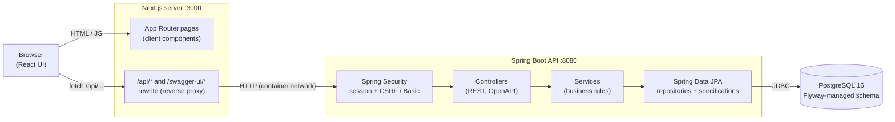
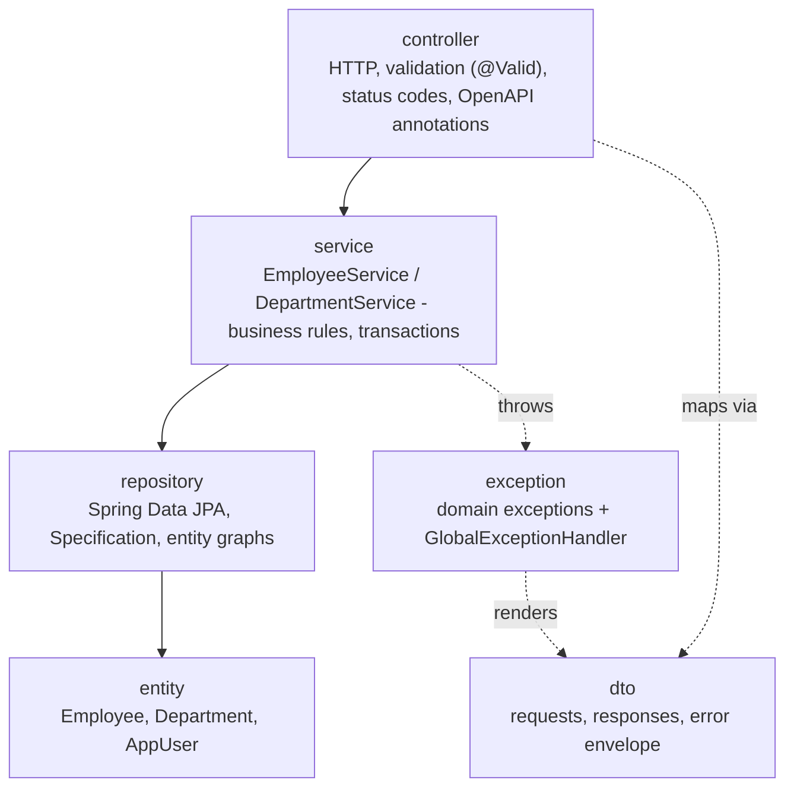
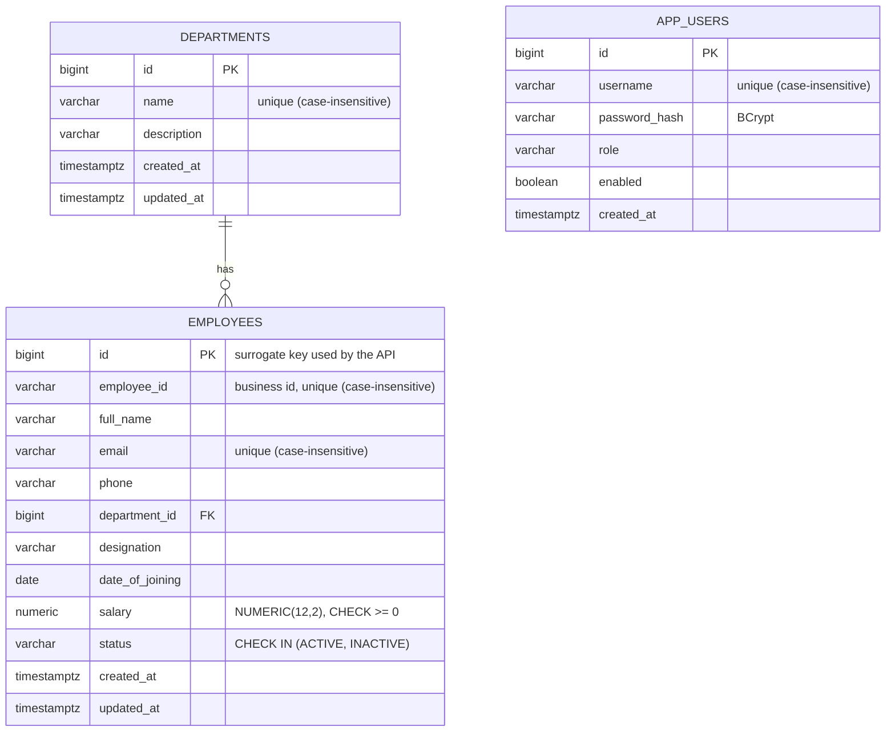

# Architecture

Rosterly is a conventional three-tier web application: a Next.js UI, a Spring Boot REST API and a
PostgreSQL database. This document explains how the pieces fit together and why the main decisions
were made.

## System overview



* The browser only ever talks to the **Next.js origin**. `/api/*` (and the Swagger UI) are proxied to the
  Spring Boot service by a Next.js rewrite. Cookies therefore stay same-site, and the browser does not need
  CORS. CORS is still configured on the API (`CORS_ALLOWED_ORIGINS`) for tools that call it directly.
* The rewrite target is baked in at **build time** (`BACKEND_INTERNAL_URL`), which is why the frontend image
  takes it as a build argument (`http://backend:8080` inside Compose).

## Backend layers



| Package | Responsibility |
|---|---|
| `controller` | Thin REST adapters. No business logic. |
| `service` | Rules: duplicate checks, department existence, allow-listed sorting, paging limits, statistics, CSV export. |
| `repository` | Persistence. `EmployeeSpecifications` builds the dynamic WHERE clause (search + department + status). |
| `entity` | JPA mappings. Timestamps via `@PrePersist/@PreUpdate`. |
| `dto` | API contract, kept separate from entities. Records with Bean Validation. |
| `exception` | Domain exceptions and a single `@RestControllerAdvice` that returns the uniform error body. |
| `security` | Filter chain, JSON 401/403 handlers, admin bootstrap, `UserDetailsService`. |
| `config` | Clock, OpenAPI, request-id logging filter, opt-in demo-data seeder. |
| `validation` | Custom constraint for the date of joining. |

### Request lifecycle: creating an employee

```mermaid
sequenceDiagram
    autonumber
    participant UI as Browser (React)
    participant N as Next.js proxy
    participant SEC as Security filters
    participant C as EmployeeController
    participant S as EmployeeService
    participant DB as PostgreSQL

    UI->>N: POST /api/employees (X-XSRF-TOKEN, session cookie)
    N->>SEC: forward
    SEC->>SEC: authenticate session, verify CSRF
    SEC->>C: request
    C->>C: @Valid EmployeeRequest (trim, formats, ranges)
    C->>S: create(request)
    S->>DB: select department; exists employee_id / email (case-insensitive)
    alt duplicate
        S-->>C: ConflictException
        C-->>UI: 409 {code, message, fieldErrors[]}
    else ok
        S->>DB: insert (unique indexes are the final guard)
        S-->>C: EmployeeResponse
        C-->>UI: 201 + Location
    end
```

If two requests race past the service-level duplicate check, the unique index rejects the second one and
`GlobalExceptionHandler` maps the constraint name (`uk_employees_email`, ...) to the same 409 response.

## Data model



* **Surrogate key + business identifier.** The API addresses employees by the generated `id`; `employee_id`
  (for example `EMP-1001`) is the human-readable identifier, normalised to upper case and unique.
* **Uniqueness is enforced twice**: in the service (friendly, field-level 409) and by unique indexes on
  `lower(employee_id)` / `lower(email)` (race-proof).
* **Search performance**: `pg_trgm` GIN indexes on `lower(full_name)` and `lower(email)` serve the
  case-insensitive "contains" search; b-tree indexes cover department, status and joining date.
* **No N+1**: list and detail queries use entity graphs to fetch the department in the same statement.
* **Money**: `BigDecimal` in Java, `NUMERIC(12,2)` in PostgreSQL. Salary is an annual amount in INR.
* **Schema ownership**: Flyway migrations in `backend/src/main/resources/db/migration`; Hibernate runs with
  `ddl-auto: validate`, so the mapping and the schema cannot silently drift.

## Authentication and security

| Concern | Approach |
|---|---|
| Browser login | `POST /api/auth/login` creates a server-side session; the `JSESSIONID` cookie is `HttpOnly`, `SameSite=Lax` (and `Secure` when `SESSION_COOKIE_SECURE=true`). No token is stored in `localStorage`. |
| CSRF | Double-submit cookie (`XSRF-TOKEN` + `X-XSRF-TOKEN` header) for every state-changing request. |
| Scripted clients | HTTP Basic (Swagger UI *Authorize*, Postman, curl). CSRF is skipped only for requests carrying an explicit `Authorization: Basic` header, which a cross-site form cannot set. The 401 response has no `WWW-Authenticate` header, so browsers never show or cache a native login prompt. |
| Passwords | BCrypt hashes in `app_users`. The first administrator is created from `ADMIN_USERNAME` / `ADMIN_PASSWORD`; if no password is configured a random one is generated and logged once. |
| Failure handling | The same `Invalid username or password` message is returned for unknown users and wrong passwords. Error bodies never contain stack traces or SQL. |
| Session fixation | The session id is rotated on login. |
| Authorisation | All `/api/**` endpoints require authentication. Swagger UI, the OpenAPI document and `/actuator/health` are public. |

## Frontend structure

```
src/
  app/                       Next.js App Router (routes only; pages are thin)
    (app)/                   authenticated area: dashboard, employees, departments, settings
    login/
  components/
    ui/                      primitives (button, input, dialog, table...) - accessible, Tailwind
    layout/                  app shell, sidebar, topbar, page header
    employees/ dashboard/ departments/ auth/ settings/ common/
  lib/
    api/                     typed API client (CSRF, error normalisation, downloads) + endpoint modules
    hooks.ts                 TanStack Query hooks and cache invalidation
    list-params.ts           directory state <-> URL query string
    employee-schema.ts       Zod schema mirroring backend validation
    auth.tsx                 session state and the route guard
```

Key frontend decisions:

* **Server-side everything for the directory.** Search, filters, sorting and paging are executed by the API;
  the UI never filters a downloaded list.
* **State lives in the URL** (`?search=&department=&status=&sortBy=&sortDir=&page=&size=`), so views can be
  bookmarked, shared and survive reloads. The URL page is 1-based for humans; the API page is zero-based.
* **One reusable form** (React Hook Form + Zod) serves create and edit. Server-side validation errors
  (`fieldErrors`) are mapped back onto the matching inputs.
* **TanStack Query** owns server state: loading/error/empty states, retries and cache invalidation after
  mutations (employees, dashboard statistics and department headcounts are invalidated together).
* **No mocked data in the app.** Fixtures exist only in tests.

## Testing strategy

| Layer | Tool | What it proves |
|---|---|---|
| Backend units | JUnit 5 + Mockito | Service business rules, CSV escaping, validation rules, error mapping, admin bootstrap. |
| Backend integration | `@SpringBootTest` + MockMvc + real PostgreSQL | HTTP contract, serialization, Flyway schema, DB constraints, filters/pagination/sorting, security chain (session, CSRF, Basic). |
| Frontend | Vitest + React Testing Library | Components, hooks, API client and form validation running against an in-memory fake of the backend contract (mocking happens only at the network boundary). |
| End to end | Playwright | The real stack: login, dashboard, directory, CSV download, full create/edit/delete lifecycle, responsive layout. |
| API | Postman / Newman | Every endpoint, with assertions, against the running API. |
